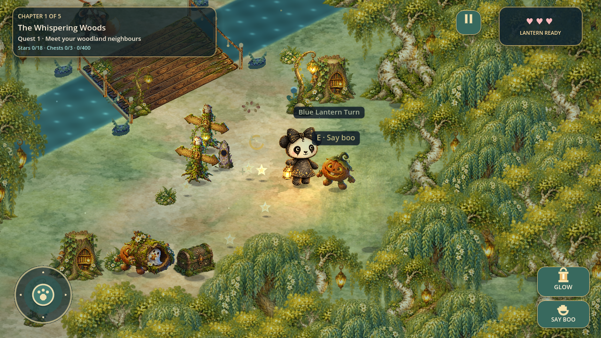
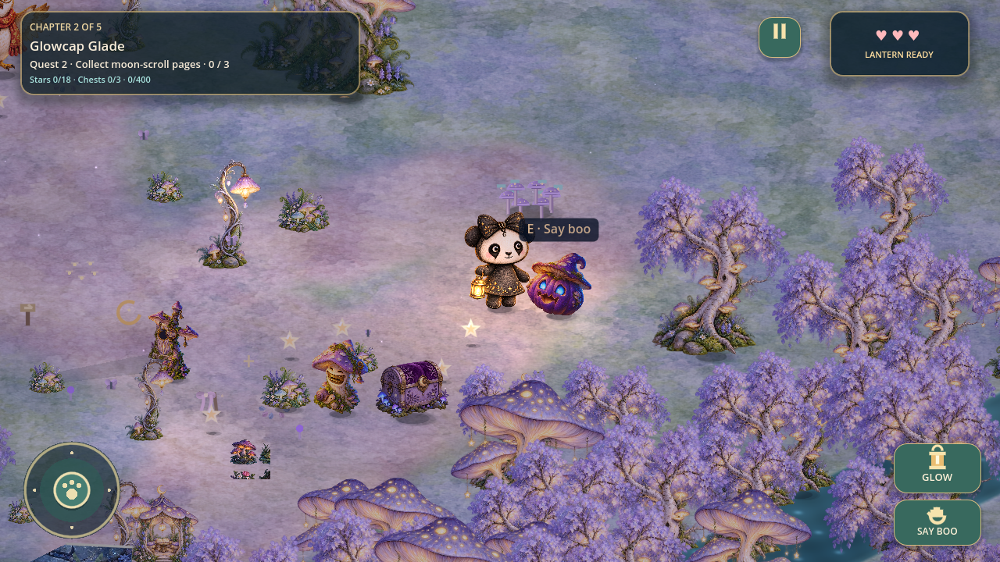
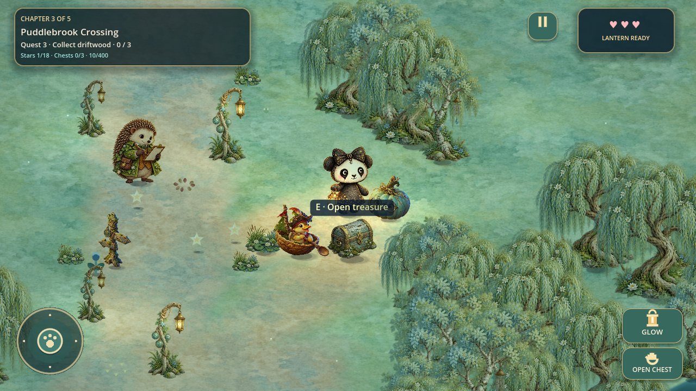
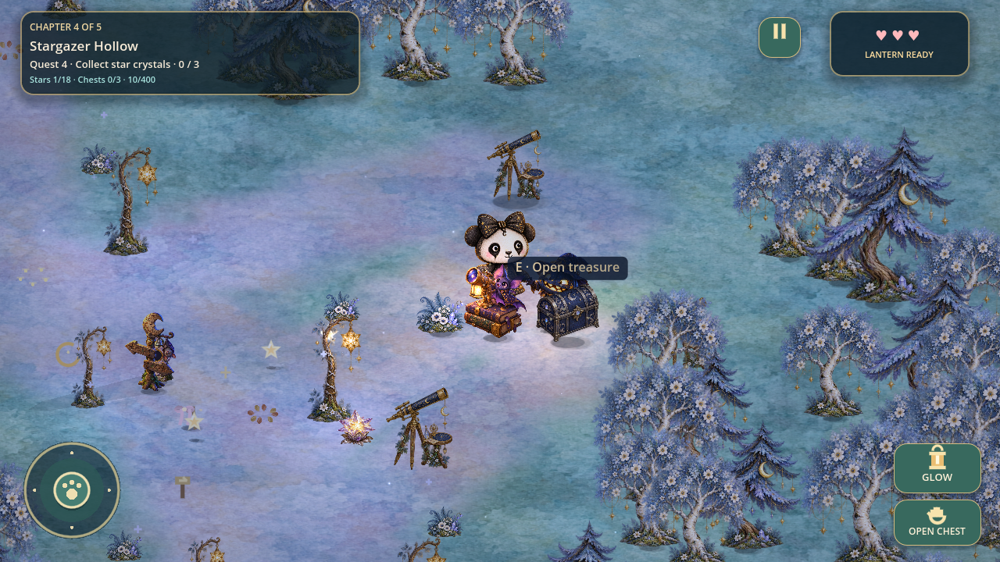
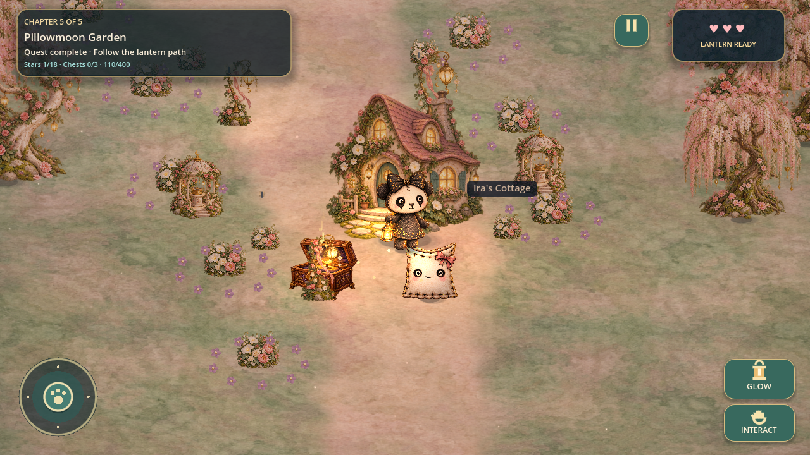
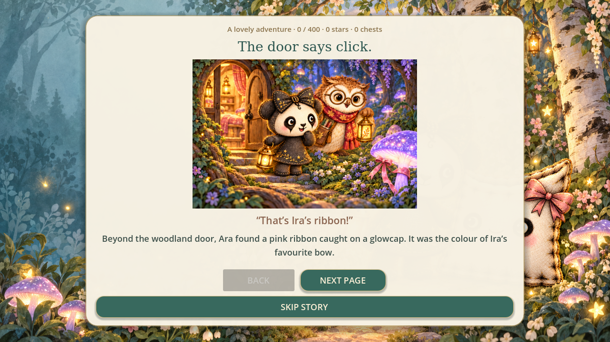
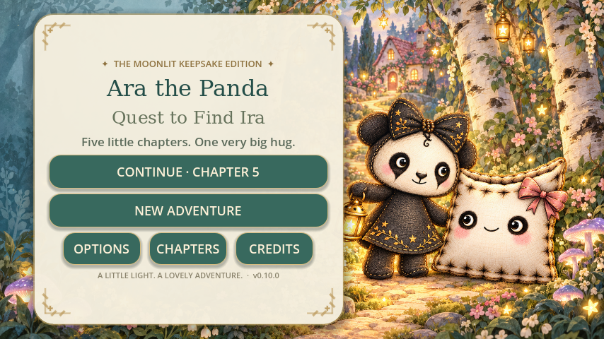

# Moonlit Keepsake — v0.10.0 review

## Result

The native game now uses a consistent illustrated cast and woodland palette
through gameplay, portraits, title art and story pages. Complete painted poses
replace the old assembled character parts. The larger characters retain smooth
walking, lantern lifts, greetings, celebrations and a still pose for Gentler
Motion.

Ara keeps her ivory and charcoal plush face, black bow and dress; gold star and
leaf embroidery adorn her outfit. Ira keeps her square ivory pillowcase, rose
bow and stitched stars. Pip's glasses and scarf, Bramble's ivy coat and clipboard,
and Moss's embroidered cape and satchel preserve the friends' identities.

## Five settings

| Chapter | Palette and scenery |
| --- | --- |
| Whispering Woods | Sage, jade and honey; ivory birches, willow canopies, daisies, leaf lanterns and a tiny stump library. |
| Glowcap Glade | Lavender, periwinkle and champagne; glowing mushroom trees, bluebells, a reading gazebo and a crescent arch. |
| Puddlebrook Crossing | Celadon, duck-egg turquoise and copper; flowering willows, waterlilies, reed lamps and a duck postbox. |
| Stargazer Hollow | Powder blue, silver and gold; star-hung trees, moon ferns, an illustrated telescope and a constellation arch. |
| Pillowmoon Garden | Dusty rose, cream and sage; blossom trees, peonies, moonflowers, a music-box gazebo and a rose-roof cottage. |







## Artwork and rendering

- Six character/creature atlases contain 24 complete alpha-bounded subjects.
- Five scenery atlases contain 30 complete alpha-bounded objects.
- One ground atlas contains ten softly painted surface washes.
- Three story atlases contain twelve scenes: eleven are used in the story,
  and one extra closing illustration is included in the beginning atlas.
- One full-width title illustration frames the sisters and the new menu.

The 16 new PNGs are stored unchanged. Actual illustrated subject bounds are
measured into `assets/keepsake/regions.json` rather than assuming equal sprite
cells. Gameplay and portraits use the same crop data. The full prompt set,
including the edit that removes an early accidental appearance of Ira, is in
`assets/keepsake/prompts.json`.

Scenery textures load one chapter at a time. Existing visibility culling, light
budgets, save formats, quest gates and collision/navigation geometry remain in
use. Trees fade around characters and required targets. The cottage sits behind
the reunion garden so the sisters stay visible. Watercolor ground samples use
continuous mirrored coordinates, avoiding the previous square paving pattern.

Flat garden backings and the old telescope silhouette were replaced with painted
adornments. The lantern glow follows Ara's painted paw, including its lifted pose,
mirroring, breathing and body tilt.

## Checks

`tools/validate_keepsake.py` runs the following native integration suites:

1. Five-chapter smoke/quest completion.
2. Landscapes and movement controls.
3. Lantern puzzles and discoveries.
4. Quests and captions.
5. Lighting, animation and graphics integration.
6. Pathways, crossings and obstacles.
7. Graphics settings and bounded ambience.
8. Character reactions, disk saves and touch input.
9. Living woodland clues, visitors and pause behavior.
10. Hidden stars, chests, crowns and chapter replay.
11. All v0.9 object interactions and their saved discoveries.
12. New atlas bounds, shared portraits, poses, story artwork and compact layouts.

The integration report is `tests/benchmarks/keepsake-validation.json`.
Native OpenGL captures cover each chapter's treasure clearing, conversation and
gate; the introduction and chapter transitions; Ira's reunion; and title,
story, pause and options layouts at a true 854×480 logical viewport.




The delivered ZIP is extracted separately and imported from scratch to check that
it includes every source asset and does not depend on the development import
cache. Engine: Godot 4.3 stable, Compatibility renderer, software OpenGL for the
captured images. Physical device performance and native platform exports are
outside this verification.

## Developer commands

```bash
python tools/validate_keepsake.py --godot /path/to/godot
python tools/package_project.py /path/to/Ira-Panda-v0.10.0.zip
```

On Linux, `tools/capture_review.py` accepts `--godot`, `--xvfb`, optional
`--xvfb-library` and `--output` for reproducible OpenGL screenshots.
`tools/catalog_keepsake_art.py` measures source alpha bounds without changing
image pixels; this optional developer tool uses Pillow, NumPy and SciPy.
