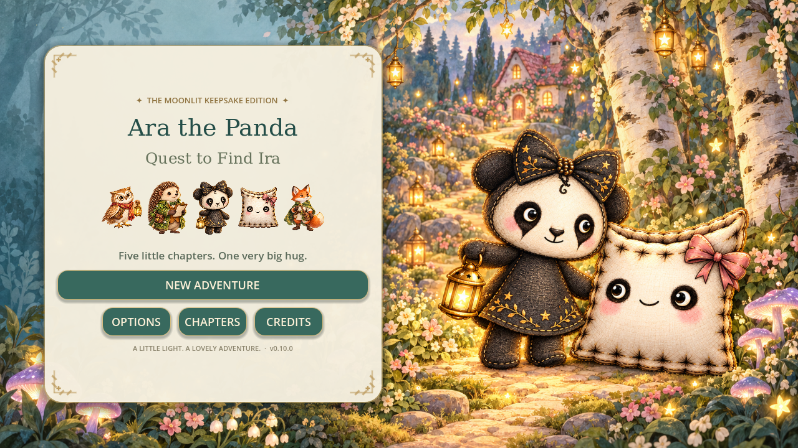

# Ara & Ira · v0.12.0 — The First Five Minutes

Open `project.godot` in Godot 4.3+ and press F5. See [opening release notes](OPENING-V0.12.md).

# Ara & Ira · v0.11.1 Reliability Patch

Open `project.godot` in Godot 4.3+ and press F5. Validated with Godot 4.5.1.

All 14 automated checks pass. See [reliability report](RELIABILITY-V0.11.1.md) for fixes, save-recovery coverage, software-rendering measurements and device-performance limits.

# Ara the Panda: Quest to Find Ira

## Current version: v0.11.0 — Storybook Welcome

Import `project.godot` in Godot 4.3+ and press F5. See [release notes](STORYBOOK-WELCOME-V0.11.md).

# Ara the Panda: Quest to Find Ira — Godot v0.10.0

## Moonlit Keepsake

A complete storybook art refresh for Ara, Ira and their woodland friends, with
new illustrated poses, five lovingly adorned settings, warmer lighting and a
new illustrated title screen. The five quests, hidden paths, treasures, chapter
album and saved adventures continue to work with the new artwork.

### Play this version

1. Extract the source ZIP into a new folder.
2. Open Godot **4.3 or newer** and import **project.godot**.
3. Let Godot finish importing the artwork, then press **F5**.

Use the Compatibility renderer. Move with WASD/arrows, the touch paw stick, or
by tapping a destination. Press **Space / GLOW** for the lantern and
**E / INTERACT** to talk, open chests and use quest stations.

This is the native Godot edition. `index.html`, `game.js` and `style.css` are the
older 2.4 browser reference; opening them does not run the new edition.

### What's new

- Four complete painted poses each for Ara, Ira, Pip, Bramble and Moss.
- New bat, rabbit, frog and moon-moth illustrations.
- Thirty new chapter scenery pieces: trees, flowers, lamps, landmarks and gates.
- Ten soft watercolor ground textures; a more readable, luminous woodland.
- Eleven refreshed story pages, matching the new character designs.
- Paper-and-gold menus, shared portrait artwork, larger characters and compact
  story layouts checked at 1280×720 and 854×480.

### Review and validation

All **12 integration suites passed** in Godot 4.3. Native OpenGL screenshots were
reviewed for all five chapters, conversations, story pages, the reunion, menus
and compact layouts. A clean ZIP import is also checked before delivery.
Physical phone hardware performance has not been measured.

See [release review](MOONLIT-KEEPSAKE-V0.10.md),
[validation report](tests/benchmarks/keepsake-validation.json),
[artwork prompts](assets/keepsake/prompts.json) and
[artwork integrity manifest](assets/keepsake/manifest.json).

Artwork was made with the built-in image generation tool. Original PNGs stay
intact; `regions.json` describes the actual subject bounds in each sprite atlas.
DejaVu Serif is included with its [licence](assets/fonts/LICENSE-DejaVu.txt).

Development branch: `godot-4-v0.10-moonlit-keepsake`.
